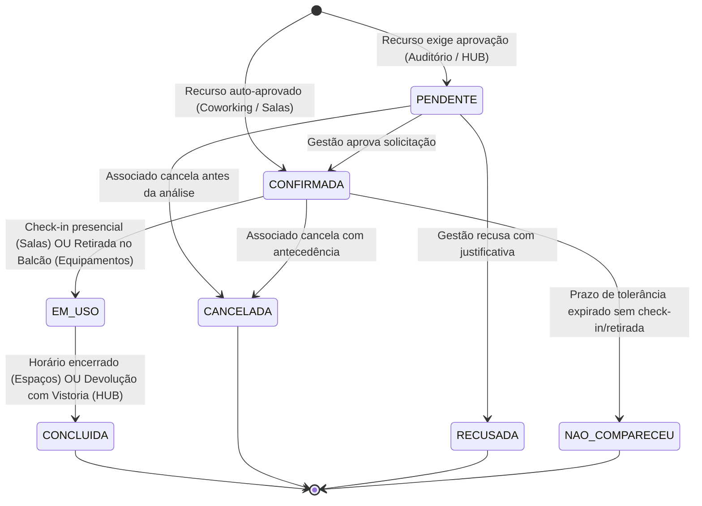

# Ciclo de Vida das Reservas e Empréstimos — Mútua-PI

**Autor**: Nicolas (Front-end)  
**Projeto**: Mútua-PI — Sistema de Gestão de Reservas  
**Referência**: [Detalhamento do projeto.pdf](file:///c:/Users/alder/Mutua/Detalhamento%20do%20projeto.pdf) (§4, §5 e D15)  

---

## 1. Visão Geral da Máquina de Estados

O ciclo de vida de uma reserva ou empréstimo na Mútua-PI foi modelado para garantir **rastreabilidade total do patrimônio**, prevenção de sobreposições de horários e transparência para o associado e a diretoria.

### 📊 Diagrama de Estados (Mermaid)

---

## 2. Descrição dos Estados

| Estado | Significado Operacional | Status do Horário no Recurso |
| :--- | :--- | :--- |
| `PENDENTE` | A solicitação foi cadastrada pelo associado e aguarda parecer formal da diretoria da Mútua-PI. | **Pré-bloqueado** (impede que outro solicite o mesmo horário enquanto sob análise). |
| `CONFIRMADA` | A reserva está formalizada e garantida para o associado. | **Ocupado / Bloqueado**. |
| `EM_USO` | O associado efetuou check-in presencial no espaço ou retirou o equipamento físico no balcão HUB mediante termo. | **Ocupado / Bloqueado**. |
| `CONCLUIDA` | O evento ou trabalho foi concluído e o equipamento foi devolvido e vistoriado sem pendências no balcão. | **Liberado** (para reservas futuras). |
| `CANCELADA` | O próprio associado desistiu da utilização dentro do prazo regulamentar. | **Liberado imediatamente**. |
| `RECUSADA` | A administração indeferiu a solicitação (por choque de agenda oficial ou pendência cadastral/anuidade). | **Liberado imediatamente**. |
| `NAO_COMPARECEU` | O solicitante não compareceu ao balcão ou não realizou o check-in na tolerância máxima de 30 minutos. | **Liberado**. |

---

## 3. Matriz de Permissões: Transição de Status × Perfil × Ação

| De | Para | Ação | Quem executa? | Regras e Validações |
| :--- | :--- | :--- | :--- | :--- |
| `[Novo]` | `PENDENTE` | Criar Reserva | `PROFISSIONAL` / `ADMIN` | Se o recurso possuir a flag `exigeAprovacao == true` (ex: Auditório Master, Drones e Estações Totais). |
| `[Novo]` | `CONFIRMADA` | Criar Reserva | `PROFISSIONAL` / `ADMIN` | Se o recurso for de livre ocupação com disponibilidade (ex: Coworking, Sala de Reuniões). |
| `PENDENTE` | `CONFIRMADA` | Despacho Favorável | `ADMIN` | Diretoria homologa no painel administrativo (`POST /admin/pendencias/{id}/aprovar`). |
| `PENDENTE` | `RECUSADA` | Recusar com Motivo | `ADMIN` | Exige envio do campo obrigatório `motivo` formal para notificação do associado. |
| `PENDENTE` | `CANCELADA` | Desistir | `PROFISSIONAL` | Pode cancelar livremente antes da decisão da diretoria. |
| `CONFIRMADA` | `EM_USO` | Retirada / Check-in | `ADMIN` (Balcão) ou `PROFISSIONAL` | Para equipamentos: exige conferência presencial de itens no balcão. Para salas: botão de check-in ativo no dia do agendamento. |
| `CONFIRMADA` | `CANCELADA` | Cancelar Reserva | `PROFISSIONAL` / `ADMIN` | Liberado se com antecedência mínima de 2 horas. |
| `CONFIRMADA` | `NAO_COMPARECEU` | Marcar Falta | `ADMIN` / Rotina Batch | Registrado se não houver check-in após a tolerância estipulada. |
| `EM_USO` | `CONCLUIDA` | Devolução / Fim | `ADMIN` (Balcão) | Para equipamentos: checklist de integridade física (`otimo`, `bom`, `regular`, `danificado`) e observações. |

---

## 4. Regras de Negócio Críticas para a API

1. **Prevenção Concorrente de Conflitos**:
   - Duas reservas do mesmo recurso **NUNCA** podem estar simultaneamente em `CONFIRMADA` ou `EM_USO` no mesmo intervalo de tempo.
   - Reservas em `CANCELADA`, `RECUSADA` e `CONCLUIDA` não colidem no tempo.
2. **Histórico Imutável**:
   - Uma vez que a reserva atinge o estado `CONCLUIDA`, `CANCELADA` ou `RECUSADA`, seus registros não devem ser deletados (`hard delete` proibido). O sistema utiliza arquivamento para manter a trilha de auditoria do CREA-PI.
3. **Privacidade (LGPD)**:
   - Em todas as listagens públicas ou administrativas, o CPF deve ser transmitido ou exibido com mascaramento (`***.456.789-**`), exceto para a geração do Termo de Guarda impresso onde o número completo é chancelado.
