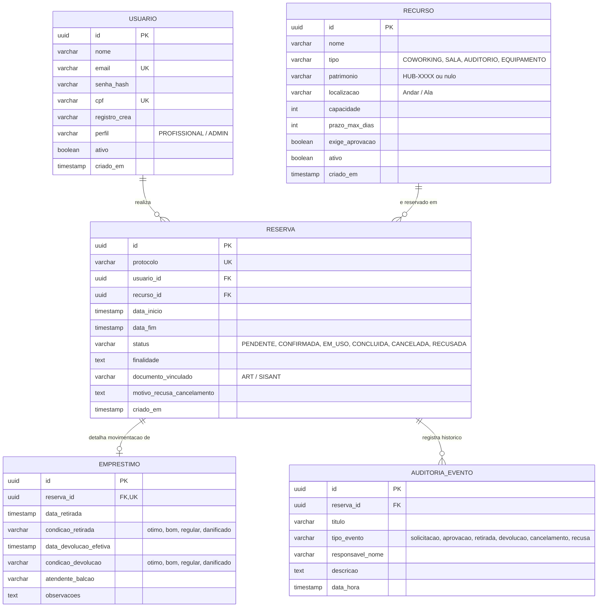

# Modelo de Banco de Dados — PostgreSQL & Entidades JPA

**Autor**: Nicolas (Front-end)  
**Projeto**: Mútua-PI — Sistema de Gestão de Reservas  
**Referência**: [Detalhamento do projeto.pdf](file:///c:/Users/alder/Mutua/Detalhamento%20do%20projeto.pdf) (§4)  

---

## 1. Decisões Fundamentais de Modelagem

Conforme deliberado na arquitetura do MVP da Mútua-PI:

1. **Entidade Única de `Recurso`**:
   - Ambientes físicos (coworking, salas privativas, auditório) e equipamentos tecnológicos (drones, estações totais, termovisores) residem na **mesma tabela `recurso`**, diferenciados pelo campo `tipo` (`COWORKING`, `SALA`, `AUDITORIO`, `EQUIPAMENTO`).
   - *Benefício*: Novos espaços ou novas categorias de equipamentos viram apenas registros cadastrais no banco, permitindo expansão sem alteração de código.
2. **Prevenção de Conflitos em Duas Camadas**:
   - Camada 1: Validação lógica nos Services do Spring Boot (`reservaService`).
   - Camada 2: **Exclusion Constraint** nativa do PostgreSQL via extensão `btree_gist`, impedindo fisicamente que duas transações concorrentes sobreponham horários para o mesmo recurso.

---

## 2. Diagrama Entidade-Relacionamento (DER)



---

## 3. Script SQL DDL Sugerido (PostgreSQL 15+)

Abaixo encontra-se a proposta de DDL pronta para ser colocada nas migrations (Flyway / Liquibase) do Spring Boot:

```sql
-- 1. Habilitar extensão para exclusão com intervalos temporais
CREATE EXTENSION IF NOT EXISTS "uuid-ossp";
CREATE EXTENSION IF NOT EXISTS "btree_gist";

-- 2. Tabela de Usuários
CREATE TABLE usuario (
    id UUID PRIMARY KEY DEFAULT uuid_generate_v4(),
    nome VARCHAR(150) NOT NULL,
    email VARCHAR(150) UNIQUE NOT NULL,
    senha_hash VARCHAR(255) NOT NULL,
    cpf VARCHAR(14) UNIQUE NOT NULL,
    registro_crea VARCHAR(30) NOT NULL,
    telefone VARCHAR(20),
    perfil VARCHAR(20) NOT NULL DEFAULT 'PROFISSIONAL', -- 'PROFISSIONAL', 'ADMIN'
    ativo BOOLEAN NOT NULL DEFAULT TRUE,
    criado_em TIMESTAMP WITH TIME ZONE DEFAULT CURRENT_TIMESTAMP
);

CREATE INDEX idx_usuario_email ON usuario(email);
CREATE INDEX idx_usuario_crea ON usuario(registro_crea);

-- 3. Tabela de Recursos (Ambientes e Equipamentos Unificados)
CREATE TABLE recurso (
    id UUID PRIMARY KEY DEFAULT uuid_generate_v4(),
    nome VARCHAR(150) NOT NULL,
    tipo VARCHAR(30) NOT NULL, -- 'COWORKING', 'SALA', 'AUDITORIO', 'EQUIPAMENTO'
    patrimonio VARCHAR(50),
    localizacao VARCHAR(150),
    capacidade INT DEFAULT 1,
    prazo_max_dias INT DEFAULT 1,
    exige_aprovacao BOOLEAN NOT NULL DEFAULT FALSE,
    ativo BOOLEAN NOT NULL DEFAULT TRUE,
    criado_em TIMESTAMP WITH TIME ZONE DEFAULT CURRENT_TIMESTAMP
);

CREATE INDEX idx_recurso_tipo ON recurso(tipo);
CREATE INDEX idx_recurso_ativo ON recurso(ativo);

-- 4. Tabela de Reservas
CREATE TABLE reserva (
    id UUID PRIMARY KEY DEFAULT uuid_generate_v4(),
    protocolo VARCHAR(30) UNIQUE NOT NULL,
    usuario_id UUID NOT NULL REFERENCES usuario(id),
    recurso_id UUID NOT NULL REFERENCES recurso(id),
    data_inicio TIMESTAMP WITHOUT TIME ZONE NOT NULL,
    data_fim TIMESTAMP WITHOUT TIME ZONE NOT NULL,
    status VARCHAR(30) NOT NULL DEFAULT 'PENDENTE',
    finalidade TEXT NOT NULL,
    documento_vinculado VARCHAR(150),
    motivo_recusa_cancelamento TEXT,
    criado_em TIMESTAMP WITH TIME ZONE DEFAULT CURRENT_TIMESTAMP,

    CONSTRAINT chk_data_valida CHECK (data_fim > data_inicio)
);

CREATE INDEX idx_reserva_usuario ON reserva(usuario_id);
CREATE INDEX idx_reserva_recurso ON reserva(recurso_id);
CREATE INDEX idx_reserva_status ON reserva(status);

-- 5. CONSTRAINT POSTGRESQL PARA PREVENÇÃO FÍSICA DE CONFLITOS DE HORÁRIO
-- Impede duas reservas ativas sobrepostas no mesmo recurso
ALTER TABLE reserva
ADD CONSTRAINT constraint_sem_conflito_horario
EXCLUDE USING gist (
    recurso_id WITH =,
    tsrange(data_inicio, data_fim) WITH &&
)
WHERE (status IN ('CONFIRMADA', 'EM_USO', 'PENDENTE'));

-- 6. Tabela de Movimentação de Balcão (Equipamentos)
CREATE TABLE emprestimo (
    id UUID PRIMARY KEY DEFAULT uuid_generate_v4(),
    reserva_id UUID UNIQUE NOT NULL REFERENCES reserva(id) ON DELETE CASCADE,
    data_retirada TIMESTAMP WITHOUT TIME ZONE,
    condicao_retirada VARCHAR(20) DEFAULT 'otimo',
    data_devolucao_efetiva TIMESTAMP WITHOUT TIME ZONE,
    condicao_devolucao VARCHAR(20),
    atendente_balcao VARCHAR(150),
    observacoes TEXT
);

-- 7. Tabela de Histórico e Auditoria (Timeline Imutável)
CREATE TABLE auditoria_evento (
    id UUID PRIMARY KEY DEFAULT uuid_generate_v4(),
    reserva_id UUID NOT NULL REFERENCES reserva(id) ON DELETE CASCADE,
    titulo VARCHAR(150) NOT NULL,
    tipo_evento VARCHAR(30) NOT NULL, -- 'solicitacao', 'aprovacao', 'retirada', 'devolucao', 'cancelamento', 'recusa'
    responsavel_nome VARCHAR(150) NOT NULL,
    descricao TEXT NOT NULL,
    data_hora TIMESTAMP WITH TIME ZONE DEFAULT CURRENT_TIMESTAMP
);

CREATE INDEX idx_auditoria_reserva ON auditoria_evento(reserva_id);
```

---

## 4. Seeds Iniciais Recomendados

Para testar o ambiente em desenvolvimento, recomenda-se criar no `data.sql`:
1. **Administrador Inicial**:
   - E-mail: `admin@mutua-pi.com.br`
   - Senha (BCrypt): `admin123`
   - Perfil: `ADMIN`
2. **Ambientes Básicos da Sede**:
   - Espaço Coworking (24 posições)
   - Sala de Reuniões Executiva A (8 posições)
   - Auditório Master Cláudio Portella (60 lugares)
3. **Equipamentos HUB**:
   - Drone DJI Phantom 4 RTK (`HUB-0042`)
   - Estação Total Leica FlexLine TS07 (`HUB-0008`)
   - Câmera Termográfica FLIR E8-XT (`HUB-0019`)
